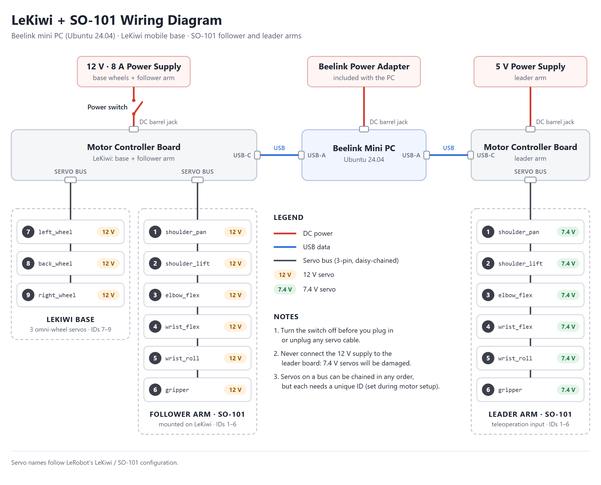

# 1. Wiring the Robot

In this step you connect the power, the USB cables and the motor cables of the robot. Nothing moves yet, and you do not run any robot software. At the end, the computer can see both motor controller boards.

Time needed: about 20 minutes.

> **Read the three safety rules below before you touch a cable.** A wrong power connection can permanently damage the motors.

## Safety rules

1. **Never connect the 12 V power supply to the leader arm.** The leader arm's motors are 7.4 V motors. 12 V damages them.
2. **Power off before plugging or unplugging any motor cable.** Turn the robot's power switch off, or pull the power plug, first.
3. **Never power the computer from the motor power supply.** The computer uses its own adapter.

## What you are connecting

The system has four parts.

| Part | What it is |
| --- | --- |
| **LeKiwi** | The mobile robot: a base with three wheels, with an SO-101 robot arm mounted on top. This arm is called the **follower** arm. |
| **Leader arm** | A second SO-101 arm that is not mounted on the robot. You move it by hand, and later the follower arm copies it. |
| **Mini PC** | The Beelink computer you set up in the [Setup guide](../Setup/README.md). It sits on the robot and runs all the software. |
| **Two motor controller boards** | Small circuit boards that sit between the computer and the motors. One is for LeKiwi (wheels and follower arm), one is for the leader arm. |

Some words used on this page:

| Word | Meaning |
| --- | --- |
| **Servo** | A motor with a built-in position sensor and its own small controller. Every joint of the arms and every wheel is one servo. |
| **Servo bus** | The chain of 3-pin cables that links the servos to a controller board. It carries both power and data. |
| **Daisy chain** | Servos connected one after another: board to servo, that servo to the next one, and so on. Each servo has two identical 3-pin sockets for this. |
| **Servo ID** | A number stored inside each servo. The computer uses it to address one servo on the bus. |

## The wiring diagram



([SVG version](images/lekiwi_wiring_diagram.svg) for zooming or printing.)

The diagram shows three **separate** power circuits:

| Power supply | Goes to | Powers |
| --- | --- | --- |
| **12 V, 8 A** supply, through the **power switch** | LeKiwi's controller board | the three wheel servos and the six follower arm servos |
| **5 V** supply | the leader arm's controller board | the six leader arm servos |
| **Beelink power adapter** | the mini PC | the computer only |

And two USB data cables, one from each controller board to the mini PC.

When everything is wired, the servos have these IDs:

| Bus | Servo | ID |
| --- | --- | --- |
| LeKiwi, follower arm | `shoulder_pan`, `shoulder_lift`, `elbow_flex`, `wrist_flex`, `wrist_roll`, `gripper` | 1 to 6 |
| LeKiwi, base | `left_wheel`, `back_wheel`, `right_wheel` | 7 to 9 |
| Leader arm | the same six joint names as the follower arm | 1 to 6 |

You do not set the IDs on this page. That is done later, in software.

## Step 1: Lay out and identify the parts

Put everything on the table **with all power supplies unplugged from the wall**.

Check that you have:

- [ ] LeKiwi (base with the follower arm mounted on it)
- [ ] the leader arm
- [ ] the mini PC and its own power adapter
- [ ] two motor controller boards (one is usually already mounted on LeKiwi, one on the leader arm's base)
- [ ] one **12 V, 8 A** power supply
- [ ] one **5 V** power supply
- [ ] the power switch for the 12 V line
- [ ] two USB cables (USB-C on the board side, USB-A on the computer side)

**Find the voltage printed on each power supply's label** and mark them so they cannot be mixed up, for example with a piece of tape that says "12 V ROBOT" and one that says "5 V LEADER". The two plugs can look identical.

## Step 2: Check the jumpers on both controller boards

Each controller board has two small plastic jumpers that select how it talks to the computer.

On **both** boards, both jumpers must be on the position marked **B** (USB).

If a jumper is on the other position, pull it straight up and push it back down on **B**.

## Step 3: Put the robot on blocks

Place LeKiwi on a box or a stack of books so that **all three wheels are off the ground** and can spin freely.

The robot stays on blocks for all of the hardware bring-up. If a wheel command goes wrong, the robot then spins its wheels in the air instead of driving off the table.

Also make sure the follower arm has free space around it in every direction.

## Step 4: Connect the servo cables on LeKiwi

All power is still unplugged.

LeKiwi's controller board has two 3-pin servo bus sockets. One chain of servos goes on each socket:

| Board socket | Chain |
| --- | --- |
| first servo bus socket | the **wheel** servos: board to one wheel servo, then to the next, then to the third |
| second servo bus socket | the **follower arm** servos: board to `shoulder_pan` at the bottom of the arm, then up the arm joint by joint to the `gripper` |

Rules for the 3-pin cables:

- The plug only fits one way. If it does not go in easily, turn it around. Do not force it.
- Push each plug in until it sits flat. A half-seated plug is the most common cause of "motor not found" later.
- It does not matter which of a servo's two sockets you use for "in" and which for "out".
- The order of the servos along a chain does not matter to the software, because each servo is found by its ID. Following the order above just keeps the cables short and tidy.

Check: every wheel servo and every arm servo on LeKiwi has at least one cable plugged in, and both chains end at the controller board.

## Step 5: Connect the servo cables on the leader arm

Same idea, one chain: the leader arm's controller board to `shoulder_pan` at the bottom, then joint by joint up to the `gripper`.

Check: all six leader servos are in the chain.

## Step 6: Connect the 12 V power to LeKiwi

1. Make sure the **power switch is in the off position**.
2. Connect the 12 V supply to the power switch, and the power switch to the round power socket (DC barrel jack) on **LeKiwi's** controller board.
3. Do **not** plug the supply into the wall yet.

This switch is the robot's **emergency stop**. It cuts the power to every motor on the robot, and it works even if the software has frozen. From now on, whenever the robot is about to move, keep one hand near it.

## Step 7: Connect the 5 V power to the leader arm

1. Take the supply you marked **5 V**. Read its label once more.
2. Connect it to the round power socket on the **leader arm's** controller board.
3. Do **not** plug it into the wall yet.

## Step 8: Connect the computer

1. Connect the Beelink power adapter to the mini PC.
2. Connect a monitor, keyboard and mouse to the mini PC if they are not connected already.
3. Leave the two USB cables to the controller boards **unplugged for now**. You plug them in one at a time in Step 10.

The mini PC has few USB ports. If the keyboard, mouse and both controller boards do not all fit, use a USB hub for the keyboard and mouse.

## Step 9: Check everything, then power up

Go through this list **before** any supply goes into the wall.

- [ ] The supply marked 12 V goes to LeKiwi's board, through the switch.
- [ ] The supply marked 5 V goes to the leader arm's board.
- [ ] The switch is off.
- [ ] All jumpers are on B.
- [ ] The robot is on blocks, wheels in the air.
- [ ] No loose cable can get caught in a wheel or in an arm joint.

Then:

1. Plug in the mini PC's adapter and switch the computer on. Log in.
2. Plug the 5 V supply into the wall.
3. Plug the 12 V supply into the wall, then turn the **power switch on**.

Nothing should move. The servos are powered but not yet commanded, so both arms stay limp and can still be moved by hand.

If you see smoke, smell burning, or a servo gets hot, **turn the switch off and pull both supplies out of the wall immediately**, then call your TA.

## Step 10: Check that the computer sees the boards

Open a terminal on the mini PC (`Ctrl` + `Alt` + `T`).

First, with **no** controller board connected by USB, run:

```bash
ls /dev/serial/by-id/
```

You should see:

```
ls: cannot access '/dev/serial/by-id/': No such file or directory
```

That is correct: no board is connected yet.

Now plug in the USB cable of **one** controller board, wait three seconds, and run the same command again:

```bash
ls /dev/serial/by-id/
```

You should now see **one** name, for example:

```
usb-1a86_USB_Single_Serial_5B8E116010-if00
```

Then plug in the USB cable of the **other** controller board, wait three seconds, and run it a third time:

```bash
ls /dev/serial/by-id/
```

You should now see **two** names, for example:

```
usb-1a86_USB_Single_Serial_5B8E116010-if00
usb-1a86_USB_Single_Serial_5B8E116601-if00
```

Each name is the permanent name of one controller board. The ten characters before `-if00` (here `5B8E116010` and `5B8E116601`) are that board's own serial number, so **your names will be different from these**. A board keeps its name no matter which USB port you use or in which order you plug the boards in.

Do not try to remember which name belongs to which board from the order you plugged them in. On the next page a program asks each board how many servos it has, which tells you for certain: the board with 9 servos is LeKiwi, the one with 6 is the leader arm.

## Checkpoint

You are done with this page when:

- [ ] both arms and all three wheels are cabled,
- [ ] the 12 V supply (through the switch) powers LeKiwi and the 5 V supply powers the leader arm,
- [ ] the robot is on blocks,
- [ ] `ls /dev/serial/by-id/` shows two names.

This page only proves that the computer can see the two **boards**. Whether the computer can also reach every **servo** behind them, and whether each board gets the right voltage, is tested on the next page.

## If something went wrong

| What you see | What to do |
| --- | --- |
| `ls /dev/serial/by-id/` still says `No such file or directory` after plugging in a board | Try the other USB port and a different USB cable. Some USB-C cables carry power only and no data. |
| The name appears and then disappears again | The USB cable or port is loose. Reseat both ends. |
| Only one name appears with both boards plugged in | Unplug both, then plug them in one at a time as in Step 10 to find out which board is not detected. Check that board's jumpers (Step 2). |
| A known-good cable and port work with one board but never with the other | The board that is never detected is probably faulty. Ask your TA for a replacement. |
| A plug does not fit a servo socket | It is upside down. Turn it around. Never force it. |

---

Next: [2. Check the servos](02_check_servos.md) | Back to the [overview](README.md)
