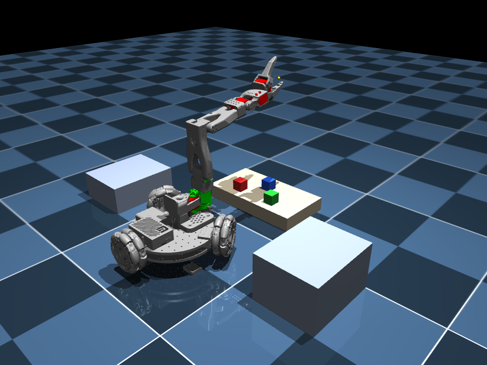
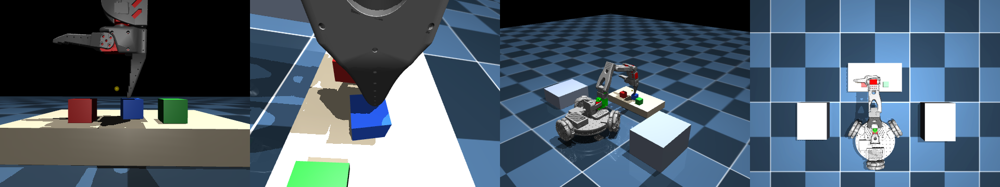

# 3. The Simulator Class

`LeKiwiSim` is a Python class that wraps the LeKiwi model into a handful of calls. It hides the 47 numbers of `qpos`, converts all units to the real robot's units, and adds a small scene to work in.

```python
from lekiwi_sim import LeKiwiSim

sim = LeKiwiSim()                                # build the robot and the scene
sim.set_command(arm=[0, 0, 0, 0, 0, 50],         # say what the robot should do
                base=[0.1, 0.0, 0.0])
sim.step()                                       # let 0.02 s of simulated time pass
state = sim.get_state()                          # see what happened
image = sim.get_image("front")                   # look through a camera
```

Its source code is one file, `~/FOR26/lekiwi_sim/simulator.py`. It is written to be read, so open it whenever you want to know how something is done.

## The scene



| Thing | Where | Details |
| --- | --- | --- |
| Robot | starts at x = 0, y = 0, facing +x | |
| `table` | in front of the robot, x from 0.26 to 0.42 m | top is 4 cm above the floor |
| `shelf_left` | to the robot's left, y from 0.26 to 0.42 m | top is 8 cm above the floor |
| `shelf_right` | to the robot's right, y from -0.42 to -0.26 m | top is 12 cm above the floor |
| `red_cube`, `green_cube`, `blue_cube` | on the table | 3 cm wide, 20 g each, free to move |

The world frame has x pointing forward from the robot's start pose, y to its left and z up. All positions are in metres.

## The calls

| Call | What it does |
| --- | --- |
| `LeKiwiSim()` | Builds the simulator with the cube scene. `LeKiwiSim(scene="keyboard")` gives a keyboard with three keys instead, and `LeKiwiSim(scene="empty")` the robot alone on an empty floor. |
| `sim.set_command(arm=..., base=...)` | Sets the targets. Leave one out to keep its old value. |
| `sim.get_command()` | Returns the current targets. |
| `sim.step(n=1, realtime=False)` | Advances `n` control periods of 0.02 s each. |
| `sim.get_state()` | Returns a dictionary describing the robot and the cubes. |
| `sim.get_image(camera, width, height)` | Returns a camera picture as a NumPy array. |
| `sim.reset()` | Puts everything back to the start. |
| `sim.set_marker(name, position)` | Draws a small ball at a position in the world. It is only a drawing and touches nothing. |
| `sim.base_to_world(point)`, `sim.world_to_base(point)` | Convert a point between the robot's base frame and the world frame. |
| `sim.open_viewer()` | Opens the interactive 3-D window. |
| `sim.viewer_is_open()` | `True` until you close that window. |
| `sim.close()` | Closes the window and frees the cameras. |

### Commands

| Argument | Values | Meaning |
| --- | --- | --- |
| `arm` | 6 numbers | `shoulder_pan`, `shoulder_lift`, `elbow_flex`, `wrist_flex`, `wrist_roll` in **degrees**, then the gripper in **percent** (0 = closed, 100 = open) |
| `base` | 3 numbers | forward speed in **m/s**, leftward speed in **m/s**, turning speed in **deg/s** (positive = counter-clockwise seen from above) |

Two different kinds of command:

- The **arm** command is a **position**. The arm moves there and then holds still. Like a real servo, a joint cannot jump: it moves at up to 180 degrees per second.
- The **base** command is a **velocity**. The base keeps moving like that until you send a different command. To stop, send `base=[0, 0, 0]`.

### State

`sim.get_state()` returns a dictionary with these keys:

| Key | Content |
| --- | --- |
| `time` | simulated seconds since the last reset |
| `arm_position` | 6 values, same order and units as the arm command |
| `arm_velocity` | 6 values, in deg/s (gripper: %/s) |
| `base_pose` | `[x, y, heading]`: position in metres and heading in degrees, in the world frame |
| `base_velocity` | `[forward, left, turn]`: m/s, m/s, deg/s, measured in the robot's own frame |
| `wheel_velocity` | 3 wheel speeds in rad/s |
| `gripper_position` | `[x, y, z]` of the point between the fingertips, in the world frame |
| `fingertip_position` | `[x, y, z]` of the tip of the fixed finger, in the world frame |
| `fingertip_in_base` | the same point in the robot's base frame (x forward, y left, z up, origin at the centre of the bottom base plate) |
| `keys` | in the keyboard scene, for each key: `{"position": [x, y, z] of its top, "pressed": True or False}` |
| `objects` | for each cube: `{"position": [x, y, z], "quaternion": [w, x, y, z]}` |

## First run

```bash
conda activate ros_mujoco
cd ~/FOR26/Assignment3/Simulate/scripts
python 03_hello_sim.py
```

You should see:

```
The state contains: ['time', 'arm_position', 'arm_velocity', 'base_pose', 'base_velocity', 'wheel_velocity', 'gripper_position', 'objects']
arm joints, in order: ('shoulder_pan', 'shoulder_lift', 'elbow_flex', 'wrist_flex', 'wrist_roll', 'gripper')
arm at start: [-0. -0. -0. -0. -0. 50.]
gripper point at start: [0.393 0.005 0.362]
objects: {'red_cube': array([0.3  , 0.06 , 0.055]), 'green_cube': array([ 0.3  , -0.06 ,  0.055]), 'blue_cube': array([0.36 , 0.   , 0.055])}

after 2.0 s of driving backwards at 0.1 m/s:
arm: [ 19.997 -29.348  41.028  30.192   0.005  99.989]
base pose [x, y, heading]: [-0.194 -0.     0.043]
base velocity [forward, left, turn]: [-0.097 -0.     0.04 ]

after the stop command, base velocity: [-0.  0. -0.]
```

Things to notice:

- The program commanded the arm to `[20, -30, 40, 30, 0, 100]` and it arrived at about `[20.0, -29.3, 41.1, 30.2, 0.0, 100.0]`. The small differences are real physics: the arm sags a little under its own weight, like a real servo arm.
- Driving backwards at 0.1 m/s for 2 s moved the base to x = -0.194 m. It is a little less than 0.2 m because the robot needs a moment to get up to speed.
- Each cube's centre is at z = 0.055 m: the table top (0.04) plus half a cube (0.015).

Open [`scripts/03_hello_sim.py`](scripts/03_hello_sim.py) and read it. It is 30 lines.

## Watch it move

> Run this in a terminal **on the lab computer's own screen**. A window cannot be shown through SSH.

```bash
python 04_viewer.py
```

A window opens. The arm swings left and right, the gripper opens and closes, and the robot turns slowly. Close the window to stop the program.

In the window you can:

| Action | How |
| --- | --- |
| Rotate the view | drag with the left mouse button |
| Move the view | drag with the right mouse button |
| Zoom | scroll |

The heart of that program is this loop:

```python
sim.open_viewer()
while sim.viewer_is_open():
    sim.set_command(arm=..., base=...)
    sim.step(realtime=True)
```

`realtime=True` makes `step()` wait, so that one simulated second takes one real second. Without it the simulation runs as fast as the computer allows (20 to 30 times faster than real time on the lab computer), which is what you want when no one is watching.

## Take pictures

The simulator has four cameras:

| Name | Where it is |
| --- | --- |
| `front` | on the front of the base, looking ahead |
| `wrist` | on the gripper, looking at the fingertips |
| `overview` | fixed in the room, looking at the whole scene |
| `top` | fixed above the scene, looking straight down |



From left to right: `front`, `wrist`, `overview`, `top`.

```bash
python 05_camera.py
```

You should see:

```
front     image shape (480, 640, 3), type uint8, pixel in the centre (red, green, blue) = [0 0 0]
wrist     image shape (480, 640, 3), type uint8, pixel in the centre (red, green, blue) = [28 28 28]
overview  image shape (480, 640, 3), type uint8, pixel in the centre (red, green, blue) = [75 13 13]
top       image shape (480, 640, 3), type uint8, pixel in the centre (red, green, blue) = [213 213 213]
saved: camera_front.png, camera_wrist.png, camera_overview.png, camera_top.png
```

An image is a NumPy array of shape `(height, width, 3)`: for every pixel, three numbers from 0 to 255 for red, green and blue. The program also saves four PNG files in the current folder. Open them from the file manager, or in VS Code.

`get_image` works without a monitor, so it also works over SSH. On the lab computer it produces about 30 images per second.

## Things to know

- **One `step()` is 0.02 s of simulated time** (50 steps per second). Inside, it runs 10 physics steps of 0.002 s.
- **The simulation only advances when you call `step()`.** `set_command` alone does nothing visible.
- **The base does not stop by itself.** The real robot stops its wheels when commands stop arriving. The simulator keeps the last base command forever, so always send a stop command.
- **The robot leans when the arm reaches out.** It is light, and the arm is heavy for its size. With the arm stretched far forward, the base tilts by a degree or two.
- **Reaching tilts the base a little.** When the arm stretches forward, the robot leans, and the fingertip ends up a few millimetres lower and closer than a rigid robot's would.

## Try it yourself

Write each of these as a new file in `~/FOR26/Assignment3/Simulate/scripts`.

1. **Square.** Drive the base along a square with 0.3 m sides and print `base_pose` at each corner. Use `LeKiwiSim(scene="empty")` so nothing is in the way. How far from the start do you end up?
2. **Slow close.** Close the gripper from 100 % to 0 % over 3 seconds and print the gripper value every 0.5 s.
3. **Follow the cube.** Using `get_state()`, turn the base until the robot faces the red cube. (Hint: `math.atan2`.)
4. **Find the cube in the picture.** Take a `top` image and find the pixel coordinates of the red cube, using only NumPy.

## Write your own simulator

`LeKiwiSim` is about 450 lines, and nothing in it is hidden. Once you are comfortable using it, read `~/FOR26/lekiwi_sim/simulator.py` from top to bottom. The parts to look for:

| Part | What to learn from it |
| --- | --- |
| `_build_model` | how to load an MJCF file and add bodies, cameras and shapes to it from Python, with `mujoco.MjSpec` |
| `_arm_to_model`, `_arm_from_model` | the unit conversion from the [previous page](02_the_lekiwi_model.md) |
| `_base_to_wheels` | how a base velocity becomes three wheel speeds |
| `step` | the control loop: write `data.ctrl`, call `mj_step` several times |
| `get_state` | how to read poses and velocities out of `data` |
| `get_image` | how to render a camera picture with `mujoco.Renderer` |

A good exercise is to write your own, smaller class from scratch: load the model, command only the arm, and return only the arm's joint angles. Then compare it with `LeKiwiSim`.

---

Previous: [2. The LeKiwi model](02_the_lekiwi_model.md) | Next: [4. Pick and place](04_pick_and_place.md)
